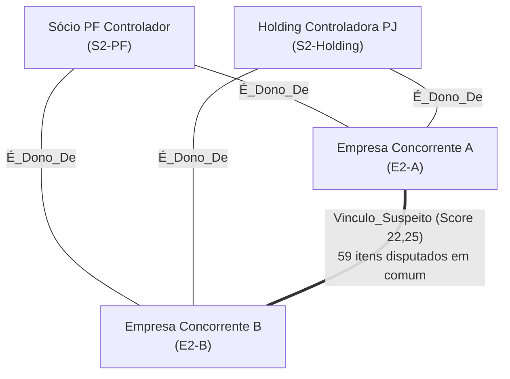

# Guia Teórico e Metodológico: Da Rede Completa ao Subgrafo de Fraudes

Este documento consolida a fundamentação técnica, a interpretação topológica e a formulação algorítmica exata implementada no repositório, servindo como **fonte de referência direta para a redação do artigo científico (padrão IEEE)**:
1. **O que o grafo completo e o subgrafo reduzido representam visual, estrutural e juridicamente;**
2. **O pipeline completo em 3 etapas (`src/01_limpeza_dados.py` $\to$ `src/02_enriquecimento_socios.py` $\to$ `src/03_reduzir_grafo.py`);**
3. **A formulação matemática exata do Escore Multidimensional e dos 4 algoritmos de redução em grafos.**

> **Nota Ética e LGPD:** Todos os exemplos e identificadores neste documento utilizam **pseudonimização rastreável** (`E1`–`E6` para empresas e `S1`–`S6` para sócios/controladores), omitindo razões sociais, nomes civis, CNPJs, logradouros completos e telefones exatos, em conformidade com a LGPD (Lei nº 13.709/2018) e com o caráter indiciário da análise estrutural.

---

## 1. O Que o Grafo Completo e o Subgrafo Representam

### A. O Grafo Completo (`grafo_cheio`)
Gerado em `results/grafo_cheio_nos.csv` (**1.788 vértices**) e `results/grafo_cheio_arestas.csv` (**5.914 arestas**), modela toda a malha de contratações públicas de Divinópolis/MG (exercício de 2025) como um grafo heterogêneo multicamada $G = (V, E, \tau, \phi, w)$:

* **Vértices de Órgãos Públicos (`Órgão`, cor Laranja, $n = 2$):**
  * `Orgao_02` (Prefeitura Municipal — 245 licitações), atuando como polo central da rede;
  * `Orgao_01` (Câmara Municipal — 19 licitações), posicionado como polo secundário periférico.
* **Vértices de Empresas Licitantes (`Empresa`, cor Verde, $n = 674$):** 673 pessoas jurídicas (CNPJ de 14 dígitos) e 1 pessoa física licitante (CPF de 11 dígitos).
* **Vértices de Sócios Reais (`Sócio Real`, cor Azul, $n = 1.112$):** recuperados via QSA da Receita Federal (BrasilAPI) e razão social de MEIs, sendo **1.044 pessoas físicas (`PF`)** e **68 pessoas jurídicas/holdings (`PJ`)**.
* **Camadas de Arestas:**
  * `Participou_Licitacao` (azul claro, $n = 680$): conecta empresa $\leftrightarrow$ órgão contratante;
  * `Concorreu_Contra` (rosa claro, $n = 4.059$): projeção ponderada por frequência absoluta acumulada de licitações e itens disputados em comum entre duas empresas (observação: o código atual utiliza contagem de coocorrência, sem cálculo de Jaccard nem algoritmo de Louvain);
  * `É_Dono_De` (verde, $n = 1.132$): conecta sócio/controlador $\leftrightarrow$ empresa;
  * `Vinculo_Suspeito` (vermelho, $n = 43$): conecta empresas concorrentes com alerta de nível `MEDIO` ($n = 37$) ou `ALTO` ($n = 6$).

### B. O Subgrafo Reduzido (`subgrafos_fraudes`)
Gerado em `results/subgrafos_fraudes_nos.csv` (**26 vértices**: 12 `Empresa` em verde e 14 `Sócio Real` em azul) e `results/subgrafos_fraudes_arestas.csv` (**23 arestas**: 17 `É_Dono_De` em verde e 6 `Vinculo_Suspeito` em vermelho com espessura proporcional ao escore $\ge 2{,}00$), isola estritamente as **6 componentes conexas de alto risco** associadas à violação potencial da competitividade e da isonomia (Art. 14 da Lei nº 14.133/2021 e Art. 337-F do Código Penal).

> **Observação de implementação:** Embora semanticamente `É_Dono_De` represente propriedade (Sócio $\to$ Empresa), na estrutura `GrafoMulticamada` em [`src/03_reduzir_grafo.py`](../src/03_reduzir_grafo.py) — assim como na renderização do Gephi — todas as arestas são armazenadas de forma simétrica (grafo não-direcionado) para viabilizar a poda de grau e a extração de componentes conexas.

---

### C. O Padrão Topológico Central: O "Triângulo Societário" ($K_3$)

Na análise de motivos estruturais (*network motifs*), o indício mais forte de concorrência simulada manifesta-se como um **3-Clique ($K_3$)** — um ciclo fechado ligando duas empresas concorrentes a um mesmo vértice controlador:



**Por que essa assinatura é crítica?**
* Formalmente, `E2-A` e `E2-B` competiram entre si em **59 itens individuais** do Processo Licitatório nº 208/2025 (Licitação 1499516, materiais odontológicos, acumulando `Peso_Concorrencia = 60`).
* Topologicamente, ambas convergem para os **mesmos dois vértices controladores** (`S2-PF` e `S2-Holding`), formando um **duplo triângulo $K_3$** e indicando ausência de independência decisória e econômica entre as proponentes.

---

### D. Os 6 Núcleos Isolados no Subgrafo de Alto Risco (Pseudonimizados)

1. **Caso 1 — Conluio Societário, Domiciliar e de Contato (`E1-A` $\times$ `E1-B` | Score 29,00 | $K_3$):**
   * Mesma sócia controladora (`S1-Comum`, acompanhada de `S1-A` e `S1-B`);
   * Mesmo endereço físico normalizado (Curitiba/PR) e mesmo telefone fixo (DDD 41);
   * Disputa no Proc. 36/2025 (Lic. 1465184 — materiais médico-cirúrgicos).
2. **Caso 2 — Duplo Triângulo Societário Fechado (`E2-A` $\times$ `E2-B` | Score 22,25 | $2 \times K_3$):**
   * Mesmo sócio pessoa física (`S2-PF`) e mesma holding controladora (`S2-Holding`);
   * Disputa simultânea em **59 itens** no Proc. 208/2025 (Lic. 1499516 — materiais odontológicos).
3. **Caso 3 — Conluio por Domicílio Fiscal Compartilhado (`E3-A` $\times$ `E3-B` | Score 10,25):**
   * Mesmo endereço físico normalizado (Bayeux/PB) e sobrenome em comum entre os sócios (`S3-A` e `S3-B`);
   * Elevada recorrência de disputa (`Peso_Concorrencia = 65`) em certames de informática e eletrônicos.
4. **Caso 4 — Conluio Familiar e de Contato (`E4-A` $\times$ `E4-B` | Score 10,00):**
   * Mesmo telefone fixo (DDD 15) e dois sobrenomes raros compartilhados entre sócios (`S4-A1`, `S4-A2` e `S4-B`);
   * Disputa no Proc. 48/2025 (Lic. 1465365 — materiais médicos descartáveis).
5. **Caso 5 — Vínculo Familiar Consanguíneo em MEI (`E5-A` $\times$ `E5-B` | Score 2,00):**
   * Dois empresários individuais cujos titulares (`S5-A` e `S5-B`) compartilham o mesmo sobrenome composto de baixa frequência no Proc. 61/2025 (Lic. 1472202 — transporte escolar).
6. **Caso 6 — Vínculo Familiar Duplo (`E6-A` $\times$ `E6-B` | Score 2,00):**
   * Dois sobrenomes raros compartilhados entre os respectivos sócios (`S6-A` e `S6-B`) no Proc. 111/2025 (Lic. 1480628 — equipamentos hospitalares).

---

## 2. O Pipeline Passo a Passo (Do Dado Bruto ao Subgrafo)

O projeto é organizado em **3 scripts Python sequenciais**:

```mermaid
flowchart TD
    A["CSVs SICOM (TCE-MG)<br>Pasta data/raw/"] --> B["1. src/01_limpeza_dados.py"]
    B -->|tabela_nos_gephi.csv<br>tabela_arestas_gephi.csv| C["2. src/02_enriquecimento_socios.py"]
    C -->|Consulta BrasilAPI / QSA<br>Cache local em JSON| D["Ficha Cadastral Completa<br>(Sócios PF/PJ, Endereços, Telefones, E-mails)"]
    D --> E["Cálculo do Escore Multidimensional s(a,b)<br>4.059 pares -> 202 alertas (6 ALTO, 37 MEDIO, 159 BAIXO)"]
    E -->|grafo_cheio_nos.csv (1.788 nós)<br>grafo_cheio_arestas.csv (5.914 arestas)| F["3. src/03_reduzir_grafo.py"]
    F --> G["Cadeia de 4 Algoritmos Formais em Grafos<br>Subgrafo Induzido -> 1-Core -> Union-Find -> K_3"]
    G --> H["subgrafos_fraudes_nos.csv (26 nós)<br>subgrafos_fraudes_arestas.csv (23 arestas)<br>(6 Componentes Conexas Prontas para o Gephi)"]
```

### Passo 1: Limpeza e Estruturação ([`src/01_limpeza_dados.py`](../src/01_limpeza_dados.py))
* **Entrada:** 4 tabelas relacionais em `data/raw/` (`licitacao.csv`, `habLicitacao.csv`, `quadroSocLicitacao.csv`, `julgLicitacao.csv`).
* **Ações:**
  1. Corrige mutação em notação científica (ex.: `2,71E+13`) e restaura zeros à esquerda (14 dígitos para CNPJ e 11 para CPF).
  2. Consolida participantes únicos da Habilitação e do Julgamento.
  3. Gera as arestas `Participou_Licitacao` e a projeção ponderada por contagem absoluta `Concorreu_Contra` (licitação + itens em comum), além da camada provisória `É_Dono_De` com IDs anonimizados pelo SICOM.
* **Saída:** `results/tabela_nos_gephi.csv` e `results/tabela_arestas_gephi.csv`.

### Passo 2: Enriquecimento via BrasilAPI e Escore Multidimensional ([`src/02_enriquecimento_socios.py`](../src/02_enriquecimento_socios.py))
* **Entrada:** `results/tabela_nos_gephi.csv` e `results/tabela_arestas_gephi.csv`.
* **Ações:**
  1. Como a tabela `quadroSocLicitacao.csv` suprimiu os CPFs e nomes dos sócios por interpretação restritiva da LGPD, consulta os **673 CNPJs** na BrasilAPI (QSA da Receita Federal), mantendo cache persistente em `results/cache_qsa_brasilapi.json` e tratando a 1 pessoa física licitante via SICOM.
  2. Recupera **1.112 sócios reais** (1.044 PF e 68 PJ) — incluindo titulares de MEIs extraídos da Razão Social — além de endereço, telefone e e-mail corporativo (com descarte automático de e-mails contendo termos de escritórios contábeis como `contabil`, `contador`, `assessoria`, `escritorio`).
  3. Para cada um dos **4.059 pares `Concorreu_Contra`**, calcula o **Escore de Vínculo exato implementado**:
     $$s(a, b) = 10 \cdot |S(a) \cap S(b)| + 10 \cdot [\text{raiz}(a) = \text{raiz}(b)] + 10 \cdot [\text{end}(a) = \text{end}(b)] + 8 \cdot [\text{tel}(a) = \text{tel}(b)] + 5 \cdot [\text{email}(a) = \text{email}(b)] + \sum_{n \in N(a) \cap N(b)} w(n)$$
     onde $N(x)$ considera apenas sócios não-PJ (após remoção do primeiro nome, 11 preposições e 10 sufixos de agnação) e $w(n)$ é uma **ponderação discreta inspirada no princípio IDF**: $w(n) = 0{,}25$ caso $n$ pertença ao dicionário de **53 sobrenomes comuns** brasileiros, e $w(n) = 1{,}00$ caso contrário.
  4. Classifica os 202 pares com $s(a, b) > 0$ em `ALTO` ($n = 6$), `MEDIO` ($n = 37$) e `BAIXO` ($n = 159$). Insere no Grafo Cheio apenas as 43 arestas `Vinculo_Suspeito` de nível `ALTO` ou `MEDIO`.
* **Saída:** `results/grafo_cheio_nos.csv`, `results/grafo_cheio_arestas.csv`, `results/socios_reais.csv` e `results/alertas_vinculos_concorrentes.csv`.

### Passo 3: Redução Algorítmica em Grafos ([`src/03_reduzir_grafo.py`](../src/03_reduzir_grafo.py))
* **Entrada:** `results/grafo_cheio_nos.csv` e `results/grafo_cheio_arestas.csv`.
* **Ações:** Aplica a cadeia de 4 algoritmos formais sobre a lista de adjacência `GrafoMulticamada`.
* **Saída:** `results/subgrafos_fraudes_nos.csv` e `results/subgrafos_fraudes_arestas.csv`.

---

## 3. Passo a Passo Detalhado dos Algoritmos de Redução

```mermaid
flowchart LR
    G["Grafo Cheio<br>(1.788 nós | 5.914 arestas)"] -->|"1. Subgrafo Induzido O(V+E)"| G1["Arestas Críticas<br>(23 arestas retidas; nós mantidos)"]
    G1 -->|"2. Poda 1-Core via BFS O(V+E)"| G2["Remoção de Nós Isolados<br>(Remove 1.762 nós de grau 0)"]
    G2 -->|"3. Union-Find O(E · α(V))"| G3["Componentes Conexas<br>(6 Núcleos Isolados, |C_i| >= 2)"]
    G3 -->|"4. Triangle Listing O(E · d_max)"| G4["Identificação do Motivo K_3<br>(3 Triângulos Societários)"]
    G4 --> S["subgrafos_fraudes<br>(26 nós | 23 arestas)"]
```



### Algoritmo 1: Subgrafo Induzido por Arestas (*Edge-Induced Subgraph*)
* **Objetivo:** Eliminar a atração central dos órgãos públicos (`Participou_Licitacao`, $n = 680$), a concorrência regular sem vínculo crítico (`Concorreu_Contra`, $n = 4.059$) e os alertas de risco moderado (`Score < 2,0`), retendo estritamente as ligações de alto risco e o quadro societário das empresas envolvidas.
* **Formulação Matemática:**  
  Seja $V_{\text{suspeito}}$ o conjunto das empresas incidentes em alguma aresta `Vinculo_Suspeito` com peso $\ge 2{,}0$. O predicado de seleção $\mathcal{P}(u, v, \text{tipo}, \text{peso})$ avaliado em ambas as pontas da aresta é:
  $$\mathcal{P}(u, v, \text{tipo}, \text{peso}) \iff (\text{tipo} = \text{'Vinculo\_Suspeito'} \land \text{peso} \ge 2{,}0) \lor (\text{tipo} = \text{'É\_Dono\_De'} \land (u \in V_{\text{suspeito}} \lor v \in V_{\text{suspeito}}))$$
* **Complexidade Temporal:** **$O(|V| + |E|)$** (cópia linear dos vértices seguida de filtragem linear das arestas).

### Algoritmo 2: Decomposição 1-Core (*Poda de Grau via Fila BFS*)
* **Objetivo:** Como o Algoritmo 1 mantém inicialmente todos os 1.788 vértices e filtra apenas as arestas, 1.762 vértices ficam com grau zero. A decomposição *1-Core* remove iterativamente todos os nós sem arestas ativas.
* **Funcionamento:**
  1. Calcula-se $d(u) = |\text{adj}[u]|$ para todo $u \in V$.
  2. Inicializa-se uma fila FIFO (`collections.deque`) com todos os vértices com $d(u) < 1$.
  3. Ao remover cada vértice $u$ da fila, decrementa-se o grau de seus vizinhos (caso existam) e retém-se apenas os vértices com grau final $\ge 1$.
* **Complexidade Temporal:** **$O(|V| + |E|)$**.

### Algoritmo 3: Decomposição em Componentes Conexas via *Union-Find* (*Disjoint-Set*)
* **Objetivo:** Particionar o subgrafo sobrevivente em núcleos independentes de suspeita ($C_1, \dots, C_6$), mantendo apenas componentes com $|C_i| \ge 2$.
* **Otimizações aplicadas:** **Compressão de Caminho (*Path Compression*)** no `find(x)` e **União por Rank (*Union by Rank*)** no `union(x, y)`.
* **Complexidade Temporal:** **$O(|E| \cdot \alpha(|V|)) \approx O(V + E)$**, onde $\alpha$ é a função inversa de Ackermann.

### Algoritmo 4: Listagem de Triângulos Societários (*Triangle Listing / Motivo $K_3$*)
* **Objetivo:** Identificar automaticamente todos os ciclos fechados do tipo $\text{Sócio} - E_1 - E_2 - \text{Sócio}$ como evidência topológica de controle econômico compartilhado entre concorrentes.
* **Funcionamento:**
  1. Constrói-se o mapa de proprietários por empresa: $\text{donos}[e] = \{s \mid (s, e) \in E_{\text{É\_Dono\_De}}\}$.
  2. Para cada aresta $(e_1, e_2)$ do tipo `Vinculo_Suspeito`, calcula-se a interseção $\text{donos}[e_1] \cap \text{donos}[e_2]$.
  3. Cada elemento $s$ da interseção forma um motivo $K_3 = \{s, e_1, e_2\}$ (resultando em **3 triângulos $K_3$**: 1 no Caso 1 e 2 no Caso 2).
* **Complexidade Temporal:** **$O(|E| \cdot d_{\max})$**, onde $d_{\max}$ é o número máximo de sócios por empresa ($\max |\text{donos}[e]|$).

---

## 4. Tabela Resumo dos Algoritmos de Redução

| Algoritmo | Papel no Pipeline | Entrada $\to$ Saída | Complexidade | Justificativa Técnica |
|---|---|---|:---:|---|
| **Subgrafo Induzido por Arestas** | Retém apenas `Vinculo_Suspeito` ($\ge 2{,}0$) e `É_Dono_De` associadas | 5.914 arestas $\to$ 23 arestas críticas | $O(V + E)$ | Elimina o polo gravitacional dos órgãos e a concorrência regular |
| **Poda de Grau 1-Core (BFS)** | Remove vértices isolados (grau zero) | 1.788 nós $\to$ 26 nós ativos | $O(V + E)$ | Descarta os 1.762 vértices sem vínculo crítico |
| **Componentes Conexas (Union-Find)** | Particiona a rede em núcleos conexos ($|C_i| \ge 2$) | 26 nós $\to$ 6 componentes conexas | $O(E \cdot \alpha(V))$ | Isola cada caso suspeito para auditoria e visualização modular |
| **Listagem de Triângulos ($K_3$)** | Extrai ciclos fechados $\text{Sócio} - E_1 - E_2$ | 6 componentes $\to$ 3 motivos $K_3$ (2 casos) | $O(E \cdot d_{\max})$ | Evidência topológica de controle societário unificado |

---

## 5. Como Executar o Pipeline (Ubuntu / Linux via Makefile)

Na raiz do repositório `AEDS-Graph`, utilize o [`Makefile`](../Makefile):

```bash
# Cria .venv (se necessário), instala pandas/numpy e executa as 3 etapas em sequência
make run

# Limpa a pasta results/ e caches __pycache__/
make clean

# Limpa apenas results/*.csv, preservando cache_qsa_brasilapi.json
make clean-csv
```

Ao final da execução, os arquivos prontos para importação no Gephi estarão gravados em:
* `results/grafo_cheio_nos.csv` (1.788 nós) e `results/grafo_cheio_arestas.csv` (5.914 arestas)
* `results/subgrafos_fraudes_nos.csv` (26 nós) e `results/subgrafos_fraudes_arestas.csv` (23 arestas)
