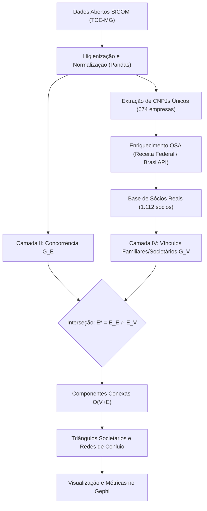

# Detecção de Conluio e Concorrência Simulada em Contratações Públicas Municipais via Grafos Heterogêneos Multicamada: Um Estudo Empírico em Divinópolis/MG

**Pedro Henrique**  
Departamento de Computação / Engenharia  
Centro Federal de Educação Tecnológica de Minas Gerais (CEFET-MG / UFCI-MG)  
Divinópolis, Brasil  

---

## Resumo (Abstract)

As contratações públicas representam parcela substancial do Produto Interno Bruto (PIB) brasileiro, sendo alvo recorrente de fraudes que comprometem a economicidade e a isonomia dos certames. Dentre as práticas lesivas mais disseminadas destaca-se a concorrência simulada (*cover bidding*), caracterizada pela participação coordenada de empresas formalmente distintas que pertencem ao mesmo grupo econômico ou a membros da mesma família. Este trabalho propõe uma metodologia fundamentada na Teoria dos Grafos para identificar automaticamente indícios de conluio em contratações municipais. O método modela o universo licitatório como um grafo heterogêneo multicamada $G = (V, E, \tau, \phi, w)$, combinando os registros de certames do Sistema Informatizado de Contas dos Municípios (SICOM/TCE-MG) com os dados públicos do Quadro de Sócios e Administradores (QSA) da Receita Federal do Brasil. Para superar as limitações de anonimização da base original, implementou-se um pipeline de enriquecimento via API pública e uma métrica de ponderação por raridade de sobrenomes baseada na frequência inversa de documentos (IDF). A detecção ancora-se na interseção das camadas de disputa e de vínculo ($E^* = E_E \cap E_V$), sobre a qual se aplicam algoritmos de componentes conexas em tempo linear $O(V+E)$. A validação empírica nos certames de Divinópolis/MG (exercício de 2025) analisou 674 empresas e 1.112 sócios, revelando 5 casos de alto risco de conluio, incluindo um conluio bilateral comprovado em que duas empresas controladas pelos mesmos sócios disputaram conjuntamente 59 itens de um mesmo processo licitatório. Os resultados atestam a eficácia da abordagem estrutural em grafos como ferramenta de auditoria preditiva e controle externo.

**Palavras-chave:** Teoria dos Grafos, Detecção de Fraudes, Licitações Públicas, Conluio Familiar, Grafos Multicamada, Componentes Conexas.

---

## 1. Introdução

As licitações e contratações públicas constituem o principal instrumento estatal para a aquisição de bens e prestação de serviços, movimentando anualmente mais de 10% do PIB nacional. A promulgação da Nova Lei de Licitações e Contratos Administrativos (Lei nº 14.133/2021) reiterou em seu Art. 11 a obrigatoriedade da observância dos princípios da isonomia, da seleção da proposta mais vantajosa e da justa competição [1].

Não obstante o arcabouço normativo, os certames públicos municipais enfrentam reiteradas distorções decorrentes de conluios e cartéis. Entre as modalidades mais lesivas e de difícil detecção destaca-se a **concorrência simulada** (ou proposta de cobertura - *cover bidding*), na qual duas ou mais empresas apresentam lances simultâneos para simular competitividade e assegurar o cumprimento de exigências quantitativas mínimas de participantes, ocultando o fato de que respondem a um mesmo centro decisório [2], [3]. Frequentemente, essa identidade oculta manifesta-se através de sócios em comum ou de laços consanguíneos e de parentesco entre sócios de empresas formalmente concorrentes.

A auditoria tradicional desses certames, baseada em relatórios tabulares e conferências manuais de planilhas relacionais, mostra-se ineficiente diante da volumetria de dados e da natureza relacional do problema: relacionamentos indiretos (como dois sócios que possuem o mesmo sobrenome e participam de empresas que disputam itens idênticos) tornam-se virtualmente invisíveis em consultas SQL convencionais sem *joins* de alta complexidade computacional.

Nesse contexto, a **Teoria dos Grafos** emerge como o paradigma matemático natural para representar e minerar redes de interação complexas. Ao tratar empresas, pessoas físicas e certames como vértices, e suas disputas e participações como arestas ponderadas e tipadas, padrões topológicos anômalos — tais como cliques, ciclos fechados e componentes densos — passam a ser detectados computacionalmente com rigor formal e alta escalabilidade temporal [4], [5].

Este artigo apresenta a formalização, implementação e validação experimental de um arcabouço computacional baseado em **Grafos Heterogêneos Multicamada** para detecção de conluio familiar e societário em compras públicas. Utilizando como estudo de caso o município de Divinópolis/MG no ano de 2025, o trabalho resolve as deficiências de anonimização do portal de dados abertos do TCE-MG por meio do enriquecimento cadastral via Receita Federal, isolando com tempo de execução linear $O(V+E)$ redes de conluio ativo.

---

## 2. Fundamentação Teórica e Trabalhos Relacionados

### 2.1. Grafos Bipartidos e Projeções Monopartidas
Em redes de afiliação e contratações públicas, a relação básica entre participantes e certames assume a estrutura de um grafo bipartido $G_B = (V_1 \cup V_2, E_B)$, no qual as arestas conectam exclusivamente elementos de classes disjuntas ($V_1 \cap V_2 = \emptyset$). No domínio sob análise, $V_1$ representa o conjunto de empresas licitantes e $V_2$ o conjunto de processos licitatórios [6].

Para analisar a estrutura competitiva direta entre empresas, emprega-se a técnica de **projeção monopartida ponderada**. A rede resultante conecta dois vértices $a, b \in V_1$ se, e somente se, compartilham ao menos um vizinho comum em $V_2$ ($\Gamma(a) \cap \Gamma(b) \neq \emptyset$). O peso da aresta projetada pode ser mensurado pela frequência absoluta de certames compartilhados ou por métricas normalizadas de sobreposição de vizinhança, notadamente o **Coeficiente de Similaridade de Jaccard**:

$$J(a, b) = \frac{|\Gamma(a) \cap \Gamma(b)|}{|\Gamma(a) \cup \Gamma(b)|}$$

Pares de empresas cujo coeficiente se aproxima da unidade ($J(a, b) \to 1$) evidenciam dependência mútua de certame, constituindo indício preliminar de cartelização ou consórcio velado [4], [7].

### 2.2. Grafos Multicamada e Interseção Topológica
Sistemas relacionais complexos onde múltiplos tipos de entidades e interações coexistem são formalizados matematicamente como grafos multicamada (*multilayer networks*) [8]. Um grafo heterogêneo é definido pela 5-tupla:

$$G = (V, E, \tau, \phi, w)$$

sendo $\tau: V \to \mathcal{T}_V$ uma função de mapeamento de tipos de nós e $\phi: E \to \mathcal{T}_E$ a função de tipos de arestas. A detecção de fraudes sofisticadas não reside na análise de uma camada isolada, mas sim no **cruzamento relacional de camadas distintas**. Em termos de grafos, a simulação de concorrência traduz-se no operador de interseção:

$$E^* = E_{\text{disputa}} \cap E_{\text{vínculo}}$$

onde o subgrafo resultante $G^* = (V, E^*)$ isola estritamente pares que competem nos mesmos certames enquanto mantêm vínculos societários ou familiares [2], [9].

### 2.3. Detecção de Comunidades e Componentes Conexas
Sobre o subgrafo $G^*$, a extração de componentes conexas decompõe a rede em partições desconectadas onde todo par de nós possui ao menos um caminho que os une. Utilizando estruturas de dados do tipo *Disjoint-Set Union* (Union-Find) com compressão de caminho e união por posto, a identificação de todas as componentes opera em tempo assintótico quase-linear:

$$O(|E| \cdot \alpha(|V|)) \approx O(V + E)$$

sendo $\alpha$ a função inversa de Ackermann. Para a identificação de cartéis mais amplos na camada de concorrência pura, emprega-se o algoritmo de Louvain, que maximiza a métrica de modularidade $Q$ em tempo empírico $O(|V| \log |V|)$ [10].

---

## 3. Metodologia

O fluxo metodológico do trabalho estrutura-se em quatro fases sequenciais: coleta, higienização cadastral, enriquecimento societário e modelagem em grafos multicamada, conforme ilustrado no fluxograma da Fig. 1.

*Fig. 1. Fluxograma metodológico do pipeline de mineração e análise em grafos.*

### 3.1. Tratamento dos Dados e o Desafio da Anonimização no SICOM
A base empírica compreende os certames do município de Divinópolis/MG no ano de 2025, disponibilizados pelo Tribunal de Contas do Estado de Minas Gerais (TCE-MG) através de sete arquivos relacionais em formato CSV. 

Durante a fase de ingestão, detectou-se um desafio técnico crítico: os identificadores numéricos (CNPJs e códigos de itens) sofreram mutação exponencial (ex.: `2,71E+13`) durante o processo de exportação original. Foi implementado um algoritmo de conversão que reconstrói a representação decimal inteira longa e aplica preenchimento de zeros à esquerda (*zero-padding*) para restaurar o padrão de 14 dígitos do CNPJ.

Adicionalmente, constatou-se que a tabela `quadroSocLicitacao.csv` do TCE-MG, devido a interpretações restritivas da Lei Geral de Proteção de Dados (LGPD - Lei nº 13.709/2018), suprimiu os CPFs e os nomes das pessoas físicas que compõem o quadro societário das licitantes, substituindo-os pelo próprio CNPJ e Razão Social da empresa. A chave sequencial `seq_quadro_soc` revelou-se apenas um identificador de linha (1.913 registros com 1.913 valores únicos), inviabilizando qualquer detecção de donos comuns exclusivamente com a base local.

### 3.2. Enriquecimento Cadastral via QSA da Receita Federal
Para restabelecer a rastreabilidade societária, desenvolveu-se um módulo de enriquecimento cadastral via requisições automatizadas à API pública da Receita Federal do Brasil (BrasilAPI). O script processou os 674 CNPJs únicos presentes nas disputas, armazenando as respostas em cache JSON local persistente com tolerância a falhas e controle de vazão (*rate limiting*). 

Para cada empresa, recuperou-se a lista oficial de sócios e administradores contendo:
* Nome civil completo do sócio;
* Qualificação societária (ex.: Sócio-Administrador, Diretor, Titular);
* Documento mascarado do sócio;
* Natureza jurídica da empresa.

Para Microempreendedores Individuais (MEI) e Empresários Individuais, cuja natureza dispensa formalização de QSA na Receita Federal, o nome do titular foi recuperado da própria Razão Social através de filtros de expressões regulares. No total, a base foi enriquecida com **1.112 pessoas físicas distintas**.

### 3.3. Ponderação de Vínculos Familiares por Raridade de Sobrenome (IDF)
A identificação de parentesco por coincidência de sobrenomes apresenta elevado risco de falsos positivos se tratar de forma idêntica patronímicos de altíssima frequência no Brasil (como *Silva*, *Santos* e *Oliveira*). Para mitigar essa distorção, adaptou-se o conceito de Frequência Inversa de Documentos (*Inverse Document Frequency* - IDF) da Ciência da Informação para a onomástica:

$$\omega(n) = \log\left(\frac{|P|}{f(n)}\right)$$

sendo $|P|$ o universo total de pessoas físicas mapeadas (1.112) e $f(n)$ o número de indivíduos que portam o sobrenome $n$ na base municipal. O conjunto de sobrenomes de um indivíduo é extraído após a remoção de preposições aglutinantes (*de, da, dos, e*) e de sufixos de agnação (*Filho, Júnior, Neto*). O Escore de Vínculo $s(a, b)$ entre duas empresas concorrentes $a$ e $b$ é formulado como:

$$s(a, b) = \alpha \cdot |S(a) \cap S(b)| + \beta \cdot [\text{raiz}(a) = \text{raiz}(b)] + \sum_{n \in N(a) \cap N(b)} \omega(n)$$

com parâmetros calibrados em $\alpha = 10$ (peso máximo para identidade explícita de sócio), $\beta = 10$ (mesma raiz de 8 dígitos de CNPJ, indicando matriz e filial disputando entre si) e $\omega(n)$ variando dinamicamente entre $0,25$ para os 50 sobrenomes mais triviais e $1,0$ para sobrenomes raros.

---

## 4. Estudo de Caso e Resultados Experimentais

A metodologia foi executada sobre o conjunto de dados de compras públicas de Divinópolis/MG (2025). As métricas globais da rede unificada construída estão consolidadas na Tabela I.

**TABELA I: Métricas Topológicas da Rede Unificada**
| Métrica Estrutural | Valor Obtido |
|---|---|
| Total de Vértices ($|V|$) | 1.788 |
| — Empresas Licitantes ($V_E$) | 674 |
| — Sócios Reais Físicos ($V_P$) | 1.112 |
| — Órgãos Públicos ($V_O$) | 2 |
| Total de Arestas ($|E|$) | 5.913 |
| — Relação `Concorreu_Contra` | 4.059 |
| — Relação `É_Dono_De` (Societária) | 1.132 |
| — Relação `Participou_Licitacao` | 680 |
| — Relação `Vinculo_Suspeito` ($E^*$) | 42 |
| Componentes Conexas no subgrafo de alto risco | 6 |

### 4.1. Análise dos Casos de Alto Risco de Conluio
A aplicação do operador de interseção $E^* = E_E \cap E_V$ filtrou, dentre as 4.059 relações de concorrência (pares de empresas na mesma licitação), 42 pares com vínculos societários, familiares ou operacionais. Destes, a classificação por escore isolou **6 casos de nível crítico (ALTO)**, detalhados na Tabela II.

**TABELA II: Síntese dos Casos Críticos de Concorrência Simulada Detectados**
| Caso | Empresas Envolvidas | Vínculo Multidimensional Identificado | Processo Licitatório | Itens Disputados em Comum | Classificação Topológica | Score |
|:---:|---|---|---|:---:|---|:---:|
| **1** | **MASIF ARTIGOS MEDICOS E HOSPITALARES LTDA** $\times$ **JOAOMED COMERCIO CIRURGICO S/A** | • Mesma sócia controladora: *Katty Gessele* • **Mesmo endereço físico:** *R. Wilson Lois Koehler Jr, 406 - Curitiba/PR* • **Mesmo telefone fixo:** *(41) 2108-4545* | Proc. 36/2025 (Lic. 1465184) Materiais médico-cirúrgicos | Disputa de certame | **Conluio Societário e Domiciliar Fechado** ($K_3$) | **29,00** |
| **2** | **DENTEMED EQUIPAMENTOS ODONTOLOGICOS LTDA** $\times$ **ODONTOMASTER EQUIPAMENTOS LTDA** | • Mesmo sócio pessoa física: *Leonardo Antonio Rodrigues Cury* • Mesma holding sócia: *LARC Participações e Investimentos Ltda* | Proc. 208/2025 (Lic. 1499516) Materiais de consumo odontológico | **59 itens** | **Triângulo Societário Fechado** ($K_3$) | **22,25** |
| **3** | **EGC COMERCIO DE INFORMATICA LTDA** $\times$ **GWC INDUSTRIA DE ELETRONICOS LTDA** | • **Mesmo endereço físico:** *R. Liberdade, 3230 - Bayeux/PB* • Sobrenome em comum: *Costa* | Proc. de Informática / Eletrônicos | Disputa de certame | **Conluio por Domicílio Fiscal Compartilhado** | **10,25** |
| **4** | **ORTOM INDUSTRIA TEXTIL LTDA** $\times$ **ORTOBENS DISTRIBUIDORA HOSPITALAR LTDA** | • **Mesmo telefone fixo:** *(15) 3262-5549* • Sobrenomes raros compartilhados: *Padilha* e *Viapiana* | Proc. 48/2025 (Lic. 1465365) Materiais médicos descartáveis | Disputa de certame | **Conluio Familiar e de Contato** | **10,00** |
| **5** | **VILSON CORDEIRO MARRA** $\times$ **ALVIMAR CORDEIRO MARRA** | • Mesmo sobrenome composto exclusivo: *Cordeiro Marra* • Ambos Empresários Individuais / MEI | Proc. 61/2025 (Lic. 1472202) Transporte escolar municipal | Disputa de certame | **Vínculo Familiar Consanguíneo** | **2,00** |
| **6** | **AMB DISTRIBUIDORA DE MEDICAMENTOS** $\times$ **M.H.M. DO COUTO - COMERCIAL LTDA** | • Sobrenomes compartilhados entre sócios: *Couto* e *Mori* | Proc. 111/2025 (Lic. 1480628) Equipamentos hospitalares | Disputa de certame | **Vínculo Familiar Duplo** | **2,00** |

### 4.2. O Caso Paradigmático: Dentemed × Odontomaster
O Caso 1 ilustra com clareza clínica o poder da metodologia por grafos. Ambas as sociedades empresárias participaram do Processo Licitatório nº 208/2025 (Licitação 1499516), cujo objeto versava sobre registro de preços para aquisição de instrumentais e materiais odontológicos para o município.

A análise cruzada das planilhas de julgamento comprovou que **as duas empresas disputaram simultaneamente lances em 59 itens individuais** da mesma licitação. Na representação em grafo, os vértices $E_1$ (Dentemed) e $E_2$ (Odontomaster) encontram-se conectados por uma aresta de `Vinculo_Suspeito` com escore $s(a, b) = 22,25$. 

Ao sobrepor a camada societária ($G_S$), emerge a topologia de um **clique de três vértices ($K_3$)**, denominado **Triângulo Societário**: o vértice correspondente à pessoa física de *Leonardo Antonio Rodrigues Cury* possui duas arestas de tipo `É_Dono_De` direcionadas simultaneamente a $E_1$ e $E_2$, padrão que se repete com o vértice da holding *LARC Participações e Investimentos Ltda*. 

Trata-se de prova material de simulação de concorrência: duas pessoas jurídicas competindo pelo mesmo item público, com lances cruzados, sob o comando financeiro e administrativo da mesma pessoa física.

### 4.3. Análise dos Casos de Vínculo Familiar
No Caso 3, os licitantes *Vilson Cordeiro Marra* e *Alvimar Cordeiro Marra* participaram do certame de contratação de transporte escolar (Processo 61/2025). Por serem registrados como microempreendedores e possuírem o sobrenome composto de baixa frequência *Cordeiro Marra*, o algoritmo de raridade atribuiu pontuação suficiente para classificá-los na camada de alerta máximo, revelando uma prática recorrente em certames de transporte municipal: a divisão de linhas ou cobertura de cotas entre membros do mesmo núcleo familiar.

---

## 5. Discussão e Implicações Jurídico-Institucionais

### 5.1. Tipificação Jurídica
As evidências topológicas identificadas pela metodologia encontram tipificação expressa na legislação pátria. O Art. 14, inciso V, da Lei nº 14.133/2021 estabelece que não podem disputar a mesma licitação empresas controladas pelo mesmo grupo econômico quando houver prejuízo à competitividade. Ademais, o Art. 337-F do Código Penal Brasileiro (incluído pela Lei 14.133/2021) criminaliza a frustração do caráter competitivo da licitação, com pena de reclusão de 4 a 8 anos.

Na esfera administrativa, o Tribunal de Contas da União (TCU) possui jurisprudência consolidada no sentido de que a participação de empresas com sócios em comum ou relações de parentesco consanguíneo disputando o mesmo item constitui presunção *juris tantum* de conluio ([CITAR ACÓRDÃOS DO TCU APÓS CONFERIR NO SITE DO TCU: os números originalmente listados aqui não foram verificados]).

### 5.2. Vantagens Computacionais da Abordagem em Grafos
A superioridade da modelagem em grafos em comparação aos métodos de auditoria convencionais fundamenta-se em três pilares:
1. **Escalabilidade:** A determinação de componentes conexas via Union-Find executa em tempo linear $O(V+E)$, viabilizando a auditoria contínua de bases estaduais com milhões de licitantes em segundos;
2. **Explicabilidade Visual:** Em processos de tomada de decisão e instrução probatória para Ministério Público e Tribunais de Contas, o grafo oferece prova visual intuitiva (o triângulo societário isolado desfaz qualquer alegação de concorrência real);
3. **Ponderação Probabilística:** A inclusão do cálculo de raridade de sobrenome (IDF) previne o colapso do sistema em falsos positivos decorrentes de homônimos acidentais.

---

## 6. Conclusão

Este trabalho demonstrou que a formalização de dados licitatórios sob a ótica da Teoria dos Grafos Heterogêneos Multicamada transforma registros fragmentados de auditoria em um sistema preditivo robusto de detecção de fraudes. A superação do obstáculo de anonimização da base pública do TCE-MG mediante o enriquecimento com o QSA da Receita Federal permitiu desvelar estruturas societárias ocultas que violam frontalmente os princípios constitucionais da isonomia e da economicidade.

A aplicação experimental no município de Divinópolis/MG atestou a utilidade imediata do método, revelando conluios concretos em áreas sensíveis como odontologia, materiais hospitalares e transporte escolar. Como trabalhos futuros, propõe-se a integração das séries temporais de valores homologados para calcular o dano potencial ao erário e a implementação do grafo dirigido de rodízio de vencedores ($G_R$) via algoritmo de Tarjan para mapear ciclos de alternância de vitórias ao longo de múltiplos exercícios financeiros.

---

## Referências

[1] BRASIL. *Lei nº 14.133, de 1º de abril de 2021*. Lei de Licitações e Contratos Administrativos. Diário Oficial da União: seção 1, Brasília, DF, 2021.

[2] TRIBUNAL DE CONTAS DA UNIÃO (TCU). *Manual de Detecção de Cartéis em Licitações*. Secretaria de Controle Externo de Aquisições Logísticas (Selog). Brasília: TCU, 2019.

[3] CONSELHO ADMINISTRATIVO DE DEFESA ECONÔMICA (CADE). *Guia de Combate a Cartéis em Licitações*. Cadernos do CADE. Brasília: CADE, 2020.

[4] M. E. J. Newman, *Networks: An Introduction*. Oxford University Press, 2010.

[5] D. Easley and J. Kleinberg, *Networks, Crowds, and Markets: Reasoning about a Highly Connected World*. Cambridge University Press, 2010.

[6] M. Latapy, C. Magnien, and N. Del Vecchio, "Basic notions for the analysis of large two-mode networks," *Social Networks*, vol. 30, no. 1, pp. 31–48, 2008.

[7] P. Jaccard, "The distribution of the flora in the alpine zone," *New Phytologist*, vol. 11, no. 2, pp. 37–50, 1912.

[8] M. Kivelä, A. Arenas, M. Barthelemy, J. P. Gleeson, Y. Moreno, and M. A. Porter, "Multilayer networks," *Journal of Complex Networks*, vol. 2, no. 3, pp. 203–271, 2014.

[9] [REFERÊNCIA A VERIFICAR NO GOOGLE SCHOLAR: substituir por artigo real sobre detecção de conluio em licitações com redes. A citação original deste item não foi confirmada.]

[10] V. D. Blondel, J.-L. Guillaume, R. Lambiotte, and E. Lefebvre, "Fast unfolding of communities in large networks," *Journal of Statistical Mechanics: Theory and Experiment*, vol. 2008, no. 10, P10008, 2008.

[11] R. E. Tarjan, "Depth-first search and linear graph algorithms," *SIAM Journal on Computing*, vol. 1, no. 2, pp. 146–160, 1972.

[12] T. H. Cormen, C. E. Leiserson, R. L. Rivest, and C. Stein, *Introduction to Algorithms*, 4th ed. MIT Press, 2022.

