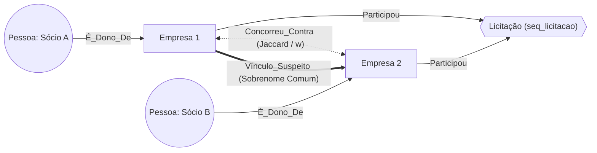
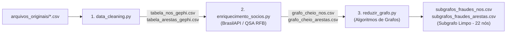

# Diário de Bordo: Modelagem de Grafos para Detecção de Fraudes em Licitações
**Projeto Final:** Estruturas em Árvores e Teoria dos Grafos (CEFET-MG / UFCI-MG)  
**Contexto:** Análise de anomalias, conluio familiar e detecção de cartéis em compras públicas no município de Divinópolis/MG (Ano de Referência: 2025).

---

## 1. O Problema e a Base de Dados

**Objetivo:** Identificar indícios de conluio e fraudes em certames licitatórios — especificamente cartelização, rodízio de vencedores, monopólio por órgão e **concorrência simulada entre empresas ligadas por sócios ou parentesco familiar**.

**Dataset Principal:** Arquivos CSV do Portal de Dados Abertos (SICOM / TCE-MG):
* `licitacao.csv`: Metadados do certame (processo, datas, modalidade, objeto).
* `habLicitacao.csv`: Empresas habilitadas e documentação cadastral.
* `julgLicitacao.csv` & `cotacaoLicitacao.csv`: Lances por item, valores e concorrentes disputando cada item.
* `homologLicitacao.csv`: Empresas vencedoras e valores homologados/adjudicados.
* `quadroSocLicitacao.csv`: Registro da participação societária no SICOM.

**Particularidades Técnicas Identificadas:**
1. *Notação Científica:* Colunas de identificação (CNPJs/CPFs e códigos de itens) sofreram mutação exponencial (ex.: `2,71E+13`) durante a exportação pelo Excel/SICOM — higienizadas no pipeline.
2. *Limitação do QSA no SICOM:* O arquivo `quadroSocLicitacao.csv` do SICOM oculta CPF e nome da pessoa física (substituídos por CNPJ e Razão Social por regras de anonimização da LGPD), e a chave `seq_quadro_soc` é apenas sequencial de banco. Para identificar os **sócios reais** e viabilizar a análise de sobrenomes/parentesco, os CNPJs participantes são enriquecidos via consulta pública ao Quadro de Sócios e Administradores (QSA) da Receita Federal do Brasil (RFB / BrasilAPI).

---

## 2. Hipóteses de Fraude e Estruturas em Grafo

Cada hipótese de fraude investigada possui uma assinatura topológica precisa:

| Hipótese | Padrão Investigado | Assinatura Topológica | Algoritmo Central | Complexidade |
|---|---|---|---|---|
| **H1: Cartel** | Grupos fechados que disputam certames sempre em bloco | Comunidades densas / cliques na projeção | Louvain, $k$-core, Bron–Kerbosch | $O(V+E)$ a $O(n \log n)$ |
| **H2: Conluio Familiar / Societário** | Empresas concorrentes disputando o mesmo item/licitação pertencentes à mesma família ou aos mesmos sócios | Arestas simultâneas de concorrência e de parentesco ($E^* = E_E \cap E_V$) | **Componentes Conexas (BFS/DFS / Union-Find)** | **$O(V + E)$** |
| **H3: Rodízio de Vencedores** | Empresas que alternam vitórias entre si nos mesmos itens ao longo do tempo | Ciclos no grafo dirigido ponderado de vitórias ($a \to b$) | Tarjan (SCC) + Reciprocidade | $O(V + E)$ |
| **H4: Monopólio / Dependência** | Órgãos capturados por poucas empresas fornecedoras | Vértices com centralidade e concentração anômalas | Centralidade de Grau / Intermediação (Brandes) | $O(V + E)$ / $O(VE)$ |

---

## 3. A Modelagem Matemática Formal

O universo do problema é formulado como um **grafo heterogêneo multicamada ponderado e atribuído**:

$$G = (V, E, \tau, \phi, w)$$

* **Vértices:** $V = L \cup E \cup P$
  * $L$: Licitações (`seq_licitacao`)
  * $E$: Empresas (CNPJs normalizados)
  * $P$: Pessoas Físicas / Sócios reais (obtidos do QSA da RFB)
* **Tipos de Vértices:** $\tau: V \to \{\text{Licitação}, \text{Empresa}, \text{Pessoa}\}$
* **Tipos de Arestas:** $\phi: E \to \{\text{Participou}, \text{Concorreu\_Contra}, \text{É\_Dono\_De}, \text{Vínculo\_Suspeito}, \text{Perdeu\_Para}\}$
* **Pesos:** $w: E \to \mathbb{R}^+$



### As Camadas do Grafo

#### Camada I: Grafo Bipartido de Participação $G_B = (E \cup L, E_B)$
* Arestas $(e, l) \in E_B \iff$ a empresa $e$ participou da licitação $l$.
* *Nota de Modelagem:* Conecta-se diretamente à **licitação** (`seq_licitacao`), permitindo topologia rica (e não ao órgão, que possui apenas 2 códigos e geraria duas estrelas triviais). O órgão permanece como atributo de $l$.

#### Camada II: Projeção Monopartida de Concorrência $G_E = (E, E_E, w)$
Construída a partir de $G_B$ pela coocorrência de empresas nos mesmos certames/itens:
* Aresta $(a, b) \in E_E \iff L(a) \cap L(b) \neq \emptyset$.
* **Métricas de Peso:**
  * Frequência absoluta: $w_{abs}(a, b) = |L(a) \cap L(b)|$.
  * Coeficiente de Jaccard: $J(a, b) = \frac{|L(a) \cap L(b)|}{|L(a) \cup L(b)|}$. Pares com $J(a, b) \to 1$ e $w_{abs}$ expressivo denotam concorrência cativa (só disputam juntos).

#### Camada III: Grafo Societário Real $G_S = (P \cup E, E_S)$
* Aresta $(p, e) \in E_S \iff$ a pessoa física $p$ consta como administradora ou sócia de $e$ no QSA oficial da Receita Federal.

#### Camada IV: Grafo de Vínculos Multidimensionais (Societários, Familiares e Operacionais) $G_V = (E, E_V, s)$
Para cada par de empresas $(a, b)$, computa-se simultaneamente o **Escore de Vínculo Multidimensional** $s(a, b)$:

$$s(a, b) = \alpha \cdot |S(a) \cap S(b)| + \beta \cdot [\text{raiz}(a) = \text{raiz}(b)] + \gamma \cdot [\text{end}(a) = \text{end}(b)] + \delta \cdot [\text{tel}(a) = \text{tel}(b)] + \sum_{n \in N(a) \cap N(b)} \omega(n)$$

Onde:
* $S(e)$ é o conjunto de sócios da empresa $e$.
* $\text{raiz}(e)$ são os 8 primeiros dígitos do CNPJ (identifica matriz e filiais disputando entre si).
* $\text{end}(e)$ é o endereço físico padronizado (logradouro + número no mesmo município/UF).
* $\text{tel}(e)$ é a linha telefônica de contato cadastrada na Receita Federal.
* $N(e)$ é o conjunto de sobrenomes dos sócios de $e$ (excluindo partículas como *de, da, dos* e sufixos como *Filho, Júnior*).
* $\omega(n) = \log\frac{|P|}{f(n)}$ é a ponderação por **raridade do sobrenome** (estilo IDF), impedindo que homônimos comuns (ex.: "Silva", "Santos") gerem falsos positivos desproporcionais, enquanto sobrenomes raros recebem peso máximo.
* Parâmetros calibrados: $\alpha = 10$ (sócio comum), $\beta = 10$ (mesma raiz), $\gamma = 10$ (mesmo endereço físico), $\delta = 8$ (mesmo telefone fixo/comercial), configurando evidências robustas de conluio operacional e societário.

#### O Núcleo de Detecção: Interseção de Camadas $G^* = (E, E^*)$
O filtro analítico prioritário do trabalho isola os pares que acumulam simultaneamente concorrência e vínculo:

$$E^* = E_E \cap E_V$$

A aplicação do algoritmo de **Componentes Conexas** sobre $G^*$ revela:
* Componentes de tamanho 2: duplas em simulação bilateral de disputa.
* Componentes de tamanho $\ge 3$: **redes familiares/societárias organizadas** atuando em certames públicos.

---

## 4. Algoritmos e Complexidade Computacional

| Algoritmo | Entrada | Finalidade | Complexidade de Pior Caso |
|---|---|---|---|
| **Projeção Bipartida Ponderada** | $G_B$ | Geração da rede de concorrentes $G_E$ com pesos de Jaccard | $O\left(\sum_{l \in L} d(l)^2\right)$ |
| **Componentes Conexas (BFS/DFS / Union-Find)** | $G^*$ e $G_S$ | Identificação de redes e clusters familiares de conluio | **$O(V + E)$** linear / $O(E \cdot \alpha(V))$ |
| **Louvain (Otimização de Modularidade)** | $G_E$ | Particionamento e detecção não supervisionada de comunidades de cartel | $O(V \cdot \log V)$ |
| **$k$-core Decomposition** | $G_E$ | Poda de participantes periféricos e extração do núcleo denso de concorrentes | $O(V + E)$ |
| **Bron–Kerbosch com Pivô** | $k$-core de $G_E$ | Enumeração de cliques maximais (grupos fechados que disputam em bloco) | $O(3^{V/3})$ no pior caso (instantâneo em grafos esparsos) |
| **Tarjan para Componentes Fortemente Conexas (SCC)** | $G_R$ (dirigido) | Identificação de ciclos de vitórias alternadas $a \to b \to c \to a$ | $O(V + E)$ |
| **Centralidade de Grau e Intermediação (Brandes)** | $G_B, G_S$ | Detecção de fornecedores hegemônicos e sócios-ponte | $O(V + E)$ / $O(V \cdot E)$ |

---

## 5. Pipeline de Execução Metodológica e Comandos

O processamento foi estruturado em um fluxo encadeado de **3 etapas automatizadas em código**, onde a saída de cada script alimenta diretamente o próximo:



### Detalhamento das Etapas:

1. **Etapa 1: Limpeza e Estruturação Base (`data_cleaning.py`)**
   * **Entrada:** Arquivos CSV brutos em `arquivos_originais/` (SICOM/TCE-MG).
   * **Processamento:** Elimina notação científica em CNPJs/CPFs, normaliza zeros à esquerda (14 dígitos), extrai empresas licitantes e mapeia o grafo bipartido de participação e a projeção de concorrência.
   * **Saída:** `resultados/tabela_nos_gephi.csv` e `tabela_arestas_gephi.csv`.

2. **Etapa 2: Enriquecimento via API e Grafo Cheio (`enriquecimento_socios.py`)**
   * **Entrada:** `tabela_nos_gephi.csv` e `tabela_arestas_gephi.csv` (geradas na Etapa 1).
   * **Processamento:** Consulta o QSA oficial da Receita Federal via BrasilAPI com cache local persistente (`cache_qsa_brasilapi.json`), vincula os 1.112 sócios reais às empresas, calcula o escore de conluio com ponderação IDF de sobrenomes raros e substitui os identificadores anônimos pelos sócios físicos reais.
   * **Saída:** O **Grafo Cheio** completo com todas as relações do município:
     * `resultados/grafo_cheio_nos.csv` (1.788 nós)
     * `resultados/grafo_cheio_arestas.csv` (5.914 arestas)
     * `resultados/socios_reais.csv` e `alertas_vinculos_concorrentes.csv`

3. **Etapa 3: Redução Algorítmica ao Subgrafo de Fraudes (`reduzir_grafo.py`)**
   * **Entrada:** `grafo_cheio_nos.csv` e `grafo_cheio_arestas.csv` (geradas na Etapa 2).
   * **Processamento:** Aplica em código:
     1. *Subgrafo Induzido por Arestas* ($O(V+E)$): remove o "buraco negro" gravitacional do órgão público (`Participou_Licitacao`) e concorrência genérica, mantendo arestas críticas de `Vinculo_Suspeito` e `É_Dono_De`.
     2. *Poda 1-Core via BFS* ($O(V+E)$): elimina todos os vértices isolados de grau 0.
     3. *Componentes Conexas (Union-Find com Path Compression)* ($O(E \cdot \alpha(V))$): particiona a rede nas ilhas de suspeita.
     4. *Listagem de Triângulos Societários ($K_3$)* ($O(E \cdot d_{\max})$): identifica formalmente os ciclos fechados Sócio $\to$ $E_1 \leftrightarrow E_2 \leftarrow$ Sócio.
   * **Saída Final:** O subgrafo podado e pronto para renderização limpa no Gephi:
     * `resultados/subgrafos_fraudes_nos.csv` (26 nós)
     * `resultados/subgrafos_fraudes_arestas.csv` (23 arestas)

---

### Como Executar o Pipeline

No terminal, execute as três etapas em sequência usando o gerenciador `uv`:

```powershell
# 1. Executa a limpeza dos dados brutos do SICOM
uv run data_cleaning.py

# 2. Executa a consulta de sócios na API e monta o Grafo Cheio
uv run enriquecimento_socios.py

# 3. Executa os algoritmos de grafos e gera o Subgrafo de Fraudes reduzido
uv run reduzir_grafo.py
```

*Alternativa usando o ambiente virtual ativo:*
```powershell
.venv\Scripts\activate
python data_cleaning.py
python enriquecimento_socios.py
python reduzir_grafo.py
```

---

## 6. Entregáveis e Checklist Final

- [x] **Modelagem Matemática Formalizada:** Grafos $G_B, G_E, G_S, G_V$ e interseção $G^* = E_E \cap E_V$ definidos.
- [x] **Seleção de Algoritmos:** Justificados teórica e temporalmente (Subgrafo Induzido, 1-Core, Componentes Conexas $O(V+E)$ e Listagem de Triângulos $K_3$).
- [x] **Pipeline de Limpeza e Exportação:** Script `data_cleaning.py` estruturado e salvando em pasta dedicada (`resultados/`).
- [x] **Mecanismo de Resolução de Sócios:** Script `enriquecimento_socios.py` implementado com cache e heurística de sobrenomes raros.
- [x] **Execução do Enriquecimento:** Extração dos 673 CNPJs na BrasilAPI concluída, vinculando 1.112 pessoas físicas reais e gerando o Grafo Cheio (`grafo_cheio_nos.csv` e `grafo_cheio_arestas.csv`).
- [x] **Redução Algorítmica do Grafo:** Script `reduzir_grafo.py` implementado e executado, reduzindo de 1.788 nós para 26 nós de alto risco (`subgrafos_fraudes_nos.csv` e `subgrafos_fraudes_arestas.csv`).
- [x] **Importação e Visualização no Gephi:** Identificação dos 3 triângulos societários fechados e subgrafo de 26 nós pronto para visualização limpa com ForceAtlas 2.
- [ ] **Artigo Científico (Template IEEE):** Rascunho em `artigo_deteccao_fraudes_ieee.md`. Falta revisar, conferir as referências (marcadas como "a verificar") e a jurisprudência citada, e migrar para o template IEEE.
- [ ] **Pitch Oral (10 min):** Rascunho do roteiro em `roteiro_pitch_apresentacao_10min.md`. Falta conferir os dados e citações jurídicas antes de apresentar.
